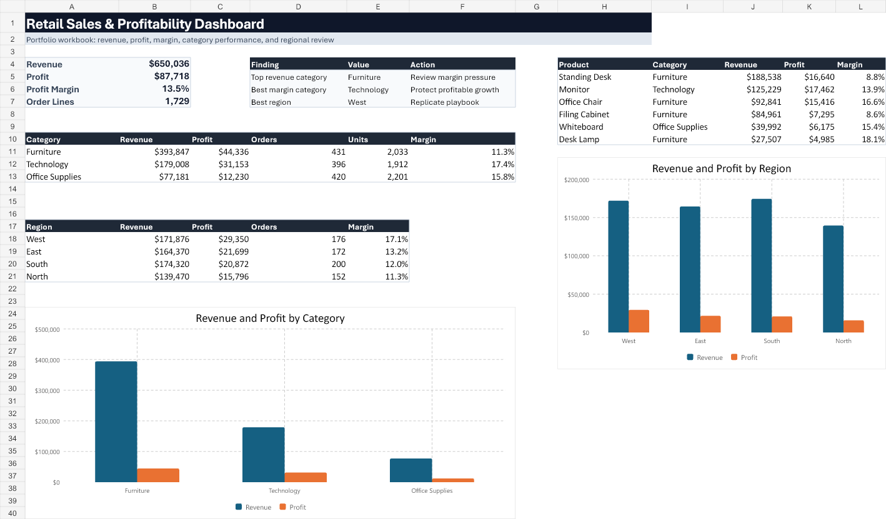

# Retail Sales & Profitability Analysis

Junior data analyst portfolio project using Excel, SQL, Python, and dashboard reporting.



## Project Overview

This project analyzes a synthetic retail sales dataset to answer a practical business question:

> Which products, regions, and customer segments are driving revenue, profit, and margin pressure?

The analysis follows a realistic data analyst workflow: generate and inspect raw data, clean and join tables, write SQL analysis queries, create summary outputs with Python, and build an Excel dashboard workbook for business stakeholders.

## Business Problem

A retail manager sees healthy sales but wants to know whether revenue growth is actually profitable. Discounts, returns, shipping costs, and low-margin products may be reducing profit even when sales volume looks strong.

The goal is to identify where management should adjust pricing, promotions, inventory focus, and regional strategy.

## Tools Used

| Tool | Purpose |
|---|---|
| Excel | Dashboard workbook, KPI review, business-facing summary |
| SQL | Table design, joins, cleaning view, revenue/profit analysis |
| Python | Data generation, cleaning, EDA, summary tables, chart exports |
| pandas | Data preparation and metric calculation |
| matplotlib | Static chart generation |

## Dataset

This project uses a realistic synthetic retail dataset created for portfolio use.

Raw tables:

- `customers.csv`
- `products.csv`
- `orders.csv`
- `order_items.csv`

Final cleaned table:

- `cleaned_retail_sales.csv`

The dataset includes common analyst problems such as inconsistent category names, discounts, returned orders, shipping costs, and multiple customer segments.

## Key Metrics

| Metric | Result |
|---|---:|
| Order lines analyzed | 1,729 |
| Revenue | $650,036 |
| Profit | $87,718 |
| Profit margin | 13.5% |
| Top revenue category | Furniture |
| Best margin category | Technology |
| Best region by profit | West |

## Key Findings

- Furniture generated the most revenue at $393,847, but had the weakest category margin at 11.3%.
- Technology generated $179,008 in revenue and had the strongest category margin at 17.4%.
- Office Supplies had the highest unit volume, but lower item prices limited total revenue.
- West was the strongest region by both profit and margin, with $29,350 profit and a 17.1% margin.
- North had the weakest regional margin at 11.3%, making it a good candidate for pricing and discount review.

## Business Recommendations

- Review Furniture discounts and shipping costs because the category generates high revenue but weak margins.
- Protect Technology promotions because it has the strongest profitability profile.
- Investigate North region pricing, fulfillment, and discounting to understand why margins lag.
- Monitor profit margin alongside revenue so growth decisions do not reward unprofitable sales.
- Segment promotions by region and customer type instead of applying broad discounts.

## Portfolio Deliverables

| Deliverable | Location |
|---|---|
| Excel dashboard workbook | `outputs/retail-sales-workbook/retail_sales_profitability_analysis.xlsx` |
| Dashboard preview image | `outputs/retail-sales-workbook/dashboard_preview.png` |
| Executive summary | `reports/executive_summary.md` |
| SQL analysis queries | `sql/03_analysis_queries.sql` |
| SQL cleaning view | `sql/02_cleaning_view.sql` |
| Python analysis script | `scripts/analyze.py` |
| Data generator | `scripts/generate_data.py` |
| Cleaned dashboard-ready data | `data/cleaned/cleaned_retail_sales.csv` |

## Project Structure

```text
retail-sales-profitability-analysis/
  dashboard/
    dashboard_plan.md
  data/
    raw/
    cleaned/
  outputs/
    retail-sales-workbook/
      dashboard_preview.png
      retail_sales_profitability_analysis.xlsx
  reports/
    executive_summary.md
    figures/
    summary_tables/
  scripts/
    generate_data.py
    analyze.py
  sql/
    01_create_tables.sql
    02_cleaning_view.sql
    03_analysis_queries.sql
  workbook_build/
    build_retail_workbook.mjs
```

## How to Run

Install Python dependencies:

```powershell
python -m pip install -r requirements.txt
```

Generate the raw dataset:

```powershell
python scripts/generate_data.py
```

Run the analysis:

```powershell
python scripts/analyze.py
```

Build the Excel workbook:

```powershell
node workbook_build/build_retail_workbook.mjs
```

## Dashboard Design

The workbook dashboard is designed for a business stakeholder who needs a quick profitability review. It includes:

- KPI cards for revenue, profit, margin, and order lines
- Revenue and profit by category
- Revenue and profit by region
- Top product table
- Action-focused finding summary

## What This Project Demonstrates

- Translating a business problem into analytical questions
- Cleaning and joining relational tables
- Calculating revenue, cost, discount, shipping, return impact, profit, and margin
- Writing SQL queries for business analysis
- Creating Python-driven summary outputs
- Building an Excel workbook that communicates findings clearly
- Presenting recommendations in a recruiter-friendly case study format
